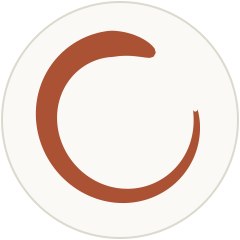
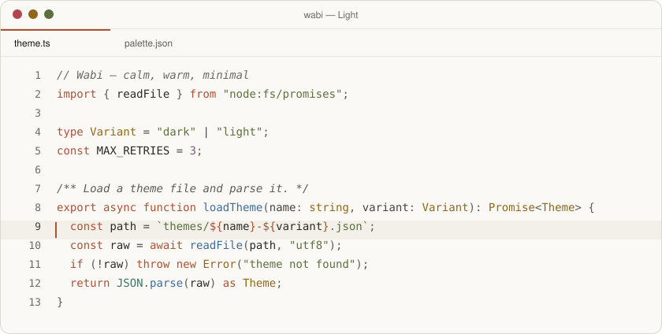
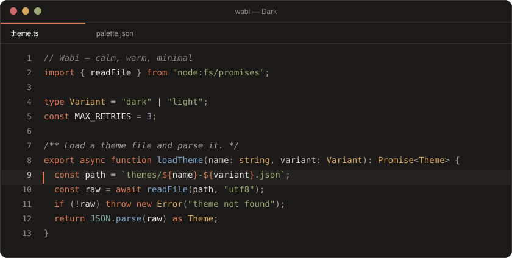
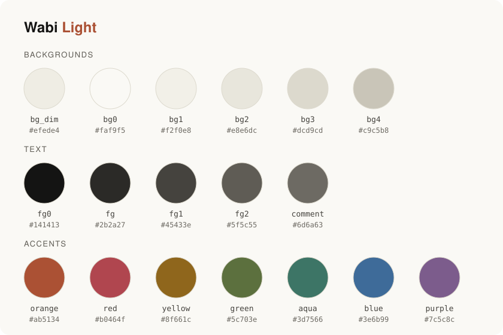
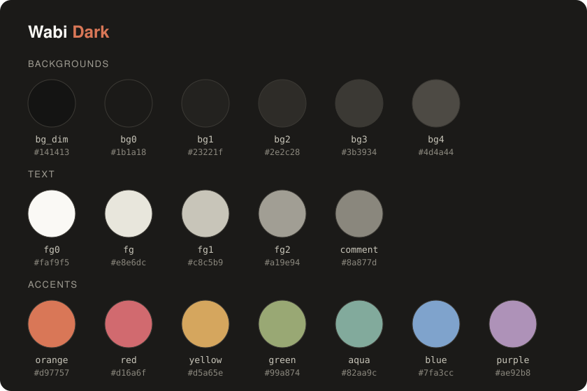

<h3 align="center">
  <picture>
    <source media="(prefers-color-scheme: dark)" srcset="assets/logo-dark.svg">
    
  </picture>
  <br/>
  Wabi
</h3>

<p align="center">
  <a href="https://en.wikipedia.org/wiki/Wabi-sabi">/ˈwɑː.bi/</a>
</p>

<p align="center">
  A minimal, calm and warm colour theme, in dark and light.
</p>

<p align="center">
  <a href="#palette">Palette</a> · <a href="#ports">Ports</a> · <a href="#showcase">Showcase</a> · <a href="docs">Docs</a>
</p>

<p align="center">
  <picture>
    <source media="(prefers-color-scheme: dark)" srcset="assets/strip-dark.svg">
    
  </picture>
</p>

<p align="center">
  <a href="https://github.com/paugarcia32/wabi/stargazers"></a>
  <a href="https://github.com/paugarcia32/wabi/releases/latest"></a>
  <a href="https://github.com/paugarcia32/wabi/issues"></a>
  <a href="LICENSE"></a>
</p>

&nbsp;

Wabi takes its name from *wabi-sabi*, the Japanese idea of finding beauty in what is simple, quiet and imperfect. The theme follows that idea: warm neutrals, a calm background shared by the whole window, and a handful of muted accents around a clay orange, used for meaning rather than decoration.

## Showcase

<picture>
  <source media="(prefers-color-scheme: dark)" srcset="assets/preview-dark.svg">
  
</picture>

<details>
<summary>Both variants side by side</summary>
<br/>

| Dark | Light |
| --- | --- |
|  |  |

</details>

## Palette

<picture>
  <source media="(prefers-color-scheme: dark)" srcset="assets/palette-dark.svg">
  
</picture>

<details>
<summary>Both variants side by side</summary>
<br/>

| Dark | Light |
| --- | --- |
|  |  |

</details>

Every colour of both variants lives in [`palette/palette.json`](palette/palette.json). All text colours meet WCAG AA (at least 4.5:1) against the background. What each colour is for is in the [style guide](docs/style-guide.md).

## Ports

| App | Variants | Install |
| --- | --- | --- |
| [Alacritty](ports/alacritty) | Dark, Light | [Instructions](ports/alacritty/README.md) |
| [Zed](ports/zed) | Dark, Light | [Instructions](ports/zed/README.md) |
| [VSCode / Cursor](ports/vscode) | Dark, Light | [Instructions](ports/vscode/README.md) |
| [Obsidian](ports/obsidian) | Dark, Light | [Instructions](ports/obsidian/README.md) |
| Neovim | | Planned |

Missing your app? [Request a port](https://github.com/paugarcia32/wabi/issues/new?template=port_request.yml), or build it yourself with the guide to [creating a port](docs/port-creation.md).

## How it's built

Every port is generated from one palette, so they always match:

```
palette/palette.json   every colour, for every variant
generator/build.js     renders ports/**/*.tmpl and assets/*.tmpl from the palette
ports/<app>/           one folder per app: templates, generated theme files, README
assets/                logo, palette and preview images (generated too)
docs/                  style guide and port creation guide
```

With Node.js installed (no dependencies):

```bash
node generator/build.js          # contrast report + regenerate every port and image
node generator/build.js --check  # contrast report only
```

Generated files are never edited by hand: change the palette or a `.tmpl` template and rebuild.

## Contributing

Contributions are welcome, from a colour fix to a whole new port. Start with [CONTRIBUTING.md](CONTRIBUTING.md); the [docs](docs) have the [style guide](docs/style-guide.md) and the guide to [creating a port](docs/port-creation.md). Everyone taking part follows the [Code of Conduct](CODE_OF_CONDUCT.md).

## Credits

Inspired by the warm neutrals and clay orange of the Anthropic brand colours, with [Gruvbox](https://github.com/morhetz/gruvbox) and Monokai as references, and [Catppuccin](https://github.com/catppuccin/catppuccin) as the model for how to organise a multi-app theme.

## License

[MIT](LICENSE)

&nbsp;

<p align="center">
  <picture>
    <source media="(prefers-color-scheme: dark)" srcset="assets/wordmark-dark.svg">
    
  </picture>
</p>
