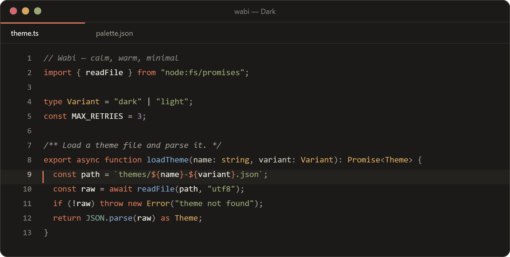
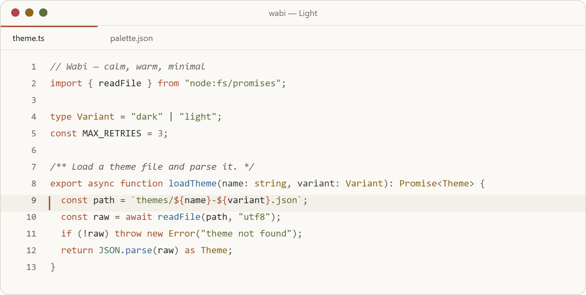

# Wabi for VSCode / Cursor

A minimal, calm and warm colour theme, in dark and light. Named after *wabi-sabi*: finding beauty in what is simple, quiet and imperfect.





- **Two themes**: **Wabi Dark** and **Wabi Light**.
- **One flat background**: sidebars, panels and bars share the editor background; only menus and popups are lifted.
- **Calm accents**: muted colours around a clay orange, used for meaning rather than decoration.
- **Readable**: every text colour has at least 4.5:1 contrast against the background.
- **Semantic highlighting**: languages with a language server (TypeScript, Rust, Python…) get richer colours.

## Install

Open the Extensions view, search for **Wabi**, and install it. Cursor, VSCodium and other editors that use Open VSX find it there under the same name.

Then run **Preferences: Color Theme** and pick **Wabi Dark** or **Wabi Light**.

To follow the system light/dark mode:

```json
"window.autoDetectColorScheme": true,
"workbench.preferredDarkColorTheme": "Wabi Dark",
"workbench.preferredLightColorTheme": "Wabi Light"
```

## More

Wabi is also available for Zed, Obsidian and Alacritty. The palette, the other ports and the issue tracker live in [paugarcia32/wabi](https://github.com/paugarcia32/wabi).

## Development

The themes are generated: don't edit `themes/wabi-*-color-theme.json` directly. Edit `palette/palette.json` or the `.tmpl` template, then from the repo root:

```powershell
node generator/build.js                    # regenerate the themes
pwsh ports/vscode/package.ps1 -Install     # package with vsce and install in VSCode (and Cursor)
```

Then run **Developer: Reload Window**. The package lands in `ports/vscode/dist/`, which git ignores. Without `-Install` the script only builds the `.vsix`.

Linking this folder into `~/.vscode/extensions` doesn't work: VSCode only loads extensions listed in its own `extensions.json`.
